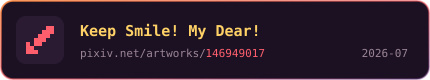
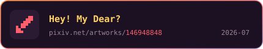
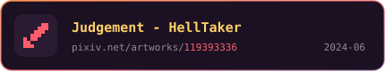

<!--
  ─────────────────────────────────────────────────────────────
   落日终端风格。图片几乎全是自托管的，不看第三方服务脸色：
     assets/hero.svg         页首 neofetch 终端卡   → tools/make_hero.py
     assets/pacman.svg       吃豆人 + Claude 小精灵 → tools/make_pacman.py
     assets/feature-*.svg    主项目横幅 / 仓库卡    → tools/make_cards.py
     assets/pin-*.svg
       ↑ 以上由 .github/workflows/stats.yml 每天自动刷新
         （入口统一是 python tools/make_cards.py）
     assets/link-*.svg       像素链接按钮（静态）   → tools/make_links.py
     assets/art-*.svg        涂鸦作品卡（静态）     → tools/make_graffiti.py
     assets/cos-*.svg        cos 对话卡（静态）     → tools/make_dialogue.py
     assets/divider.svg      分隔线（手写）
     Alastor.Cos/*.webp      cos 主图（本地原图裁出，原图走 .gitignore）
                             与两个角色头像（现拉官方立绘裁圆）
                             → tools/make_cos_assets.py
   配色与等宽排版的公共零件在 tools/sunset.py。
   仅剩的外部依赖：count.getloli.com 计数器、
   r6.awads.cc 图标（你自己的服务）。
  ─────────────────────────────────────────────────────────────
-->

 

平时写广告过滤规则和一些小工具，偶尔画画、出 cos。

## `~/projects`

### `ads-rule/` 秋风广告规则

众多优秀广告规则的上游，开源社区中最棒的广告过滤器列表之一。 🌐 <a href="https://awavenue.top">awavenue.top</a> · 📦 <a href="https://github.com/TG-Twilight/AWAvenue-Ads-Rule">GitHub</a>

### `apps/` 应用与实用工具

<table>
<tr>
<td width="46%"></td>
<td>第三方酷安客户端，从 c001apk-flutter 接手过来继续维护。修了失效的 API，补了简体中文，能看动态、文章和评论，收藏和屏蔽都存在本地。Flutter 写的，目前主要顾 Android 和 Windows。</td>
</tr>
<tr>
<td width="46%"></td>
<td>给 Android 设备开一个固定端口的无线 ADB，走 Sui / Shizuku 或者直接 <code>su</code>。会检查端口冲突，失败了自动回滚，也可以开机恢复。配上 Tailscale 可以跨网络调试。</td>
</tr>
<tr>
<td width="46%"></td>
<td>通话记录编辑器：增删改，外加 JSON 备份和恢复，恢复时会去重。Kotlin + Compose 写的原生应用，没有申请联网权限。</td>
</tr>
<tr>
<td width="46%"></td>
<td>把窗口钉在最上层的小工具。原作者 2015 年停在 1.32，我接着做了 64 位、简体中文、深色模式、Per-Monitor DPI 和便携模式，还补上了缺失的私有框架，现在源码拿下来就能编译。</td>
</tr>
</table>

### `web/` Web 工具与服务

<table>
<tr>
<td width="46%"></td>
<td>忘了 Android 签名文件（keystore）密码时用的找回工具。全在浏览器本地算，不上传任何东西。 🌐 <a href="https://jks.awads.cc">jks.awads.cc</a></td>
</tr>
<tr>
<td width="46%"></td>
<td>基于 WebUSB 的网页刷机工具。在 fastboot.js 上换了 Material 3 界面，加了中英双语和危险操作的二次确认。vibecoding 练手作，刷机前自己想清楚。</td>
</tr>
<tr>
<td width="46%"></td>
<td>查一个仓库被哪些「大佬」Star 过。 🌐 <a href="https://star.awads.cc">star.awads.cc</a></td>
</tr>
<tr>
<td width="46%"></td>
<td>游戏图标的 SVG API，可以贴在 README 或任何网页里，也能自己部署。下面 cosplay 里的 R6 干员图标就是它出的。 🌐 <a href="https://r6.awads.cc">r6.awads.cc</a></td>
</tr>
</table>

### `games/` 游戏与折腾

<table>
<tr>
<td width="46%"></td>
<td>洞窟物语引擎 doukutsu-rs 的分支。加了简中 / 英 / 日三语、手柄布局和更强的震动，Android 上支持离线资源和存档迁移，蓝牙手柄的震动是借 Shizuku 做的。</td>
</tr>
<tr>
<td width="46%"></td>
<td>AC130Beta 的 Cheat Engine 修改表：金钱、移动、弹药、伤害这些，重生和换枪之后依然生效。仓库里有 Lua 源码、CT 生成工具和模拟内存测试。只用于单人或自己开的房间。</td>
</tr>
</table>

## `~/graffiti`

偶尔画点东西，都发在 Pixiv：**[Twilight](https://www.pixiv.net/users/106832575)**

 

## `~/cosplay`

### `rainbow-six-siege-x/` Tom Clancy's Rainbow Six Siege X — Jäger & Solis in Hotel

### `hazbin-hotel/` Hazbin Hotel — Alastor, the Radio Demon

<table>
<tr>
<td width="46%"></td>
<td>

📍 2026 成都世界动漫展 · 5.1 – 5.4

</td>
</tr>
</table>

  

🌅 <i>See you on the other side of the sunset.</i>

