<!--
  ─────────────────────────────────────────────────────────────
   落日终端风格。图片几乎全是自托管的，不看第三方服务脸色：
     assets/hero.svg         页首 neofetch 终端卡   → tools/make_hero.py
     assets/pacman.svg       吃豆人 + Claude 小精灵 → tools/make_pacman.py
     assets/feature-*.svg    招牌横幅 / 仓库卡      → tools/make_cards.py
     assets/pin-*.svg
       ↑ 以上由 .github/workflows/stats.yml 每天自动刷新
         （入口统一是 python tools/make_cards.py）
     assets/link-*.svg       像素链接按钮（静态）   → tools/make_links.py
     assets/divider.svg      分隔线（手写）
     Alastor.Cos/*.webp      cos 主图（本地原图裁出，原图走 .gitignore）
                             与两个角色头像（现拉官方立绘裁圆）
                             → tools/make_cos_assets.py
   配色与等宽排版的公共零件在 tools/sunset.py。
   仅剩的外部依赖：count.getloli.com 计数器、
   r6.awads.cc 图标（你自己的服务）。
  ─────────────────────────────────────────────────────────────
-->

<a href="https://me.awads.cc/"></a>

 

日落之地的赛博牛仔 —— 白天写规则，晚上画画，周末出 cos。


## `~/projects`

### 招牌

<a href="https://github.com/TG-Twilight/AWAvenue-Ads-Rule"></a>

<b>秋风广告规则</b> —— 众多优秀广告规则的上游，开源社区中最棒的广告过滤器列表之一。 🌐 <a href="https://awavenue.top">awavenue.top</a> · 📦 <a href="https://github.com/TG-Twilight/AWAvenue-Ads-Rule">GitHub</a>

### 应用与实用工具

<table>
<tr>
<td width="50%" valign="top">

<a href="https://github.com/TG-Twilight/c001apk"></a>

<b>c001apk</b> —— 基于 c001apk-flutter 接续维护的轻量非官方酷安客户端。修复 API、完善简体中文体验，支持浏览动态、文章与评论，提供本地收藏与屏蔽；使用 Flutter，目前重点维护 Android 与 Windows。

</td>
<td width="50%" valign="top">

<b>Any ADB</b> —— 借 Sui / Shizuku（root）或直接 <code>su</code>，给任意 Android 设备开一个固定的 TCP ADB 端口。端口冲突检测、失败自动回滚、可选开机恢复；配上 Tailscale 就能跨网络调试。

</td>
</tr>
<tr>
<td width="50%" valign="top">

<b>通话记录编辑器</b> —— Kotlin + Compose + Material 3 Expressive 的原生通话记录编辑 / 备份工具。增删改、JSON 备份与去重恢复，全程本地、没有联网权限。

</td>
<td width="50%" valign="top">

<a href="https://github.com/TG-Twilight/DeskPins"></a>

<b>DeskPins 社区版</b> —— 把任意窗口钉在最上层。接着原作者 2015 年停更的 1.32 往下做：64 位、简体中文、深色模式、Per-Monitor DPI、便携模式，还补上了缺失的私有框架，<b>第一次让任何人都能编译它</b>。

</td>
</tr>
</table>

### Web 工具与服务

<table>
<tr>
<td width="50%" valign="top">

<a href="https://github.com/TG-Twilight/JKS.Recover"></a>

纯客户端的 Android 签名文件（keystore）密码找回工具，全程本地运算，什么都不上传。 🌐 <a href="https://jks.awads.cc">jks.awads.cc</a>

</td>
<td width="50%" valign="top">

基于 WebUSB 的网页刷机面板，给 fastboot.js 换上 Material 3 界面、中英双语和危险操作二次确认。<i>纯属 vibecoding 练手，刷机前请三思。</i>

</td>
</tr>
<tr>
<td width="50%" valign="top">

<a href="https://github.com/TG-Twilight/Starstruck"></a>

一键统计某个仓库被哪些「显赫人物」Star 过，顺便探索大佬们的影响力圈子。 🌐 <a href="https://star.awads.cc">star.awads.cc</a>

</td>
<td width="50%" valign="top">

向所有人、在任何地方展示你喜爱的游戏图标 —— 易于集成、可自托管的 SVG 图标 API。 🌐 <a href="https://r6.awads.cc">r6.awads.cc</a>

</td>
</tr>
</table>

### 游戏与折腾

<table>
<tr>
<td width="50%" valign="top">

<b>洞窟物语</b>引擎 doukutsu-rs 的社区分支 —— 简中 / 英 / 日三语、手柄布局与增强震动、Android 离线资源与存档迁移，还有借 Shizuku 驱动蓝牙手柄震动的独门绝技。

</td>
<td width="50%" valign="top">

<a href="https://github.com/TG-Twilight/AC130.Zombie.Gunship"></a>

<b>AC130Beta 本地游戏修改表</b> —— 用 Cheat Engine 折腾金钱、移动、弹药与伤害等属性，支持重生和换枪后跟随。包含 Lua 源码、CT 生成工具与模拟内存测试，供单人或自建房间使用。

</td>
</tr>
</table>

## `~/graffiti`

偶尔画点东西 —— Pixiv: **[Simon Twilight](https://www.pixiv.net/users/106832575)**

- [146949017 — *Keep Smile！My Dear！*](https://www.pixiv.net/artworks/146949017)
- [146948848 — *Hey! My Dear?*](https://www.pixiv.net/artworks/146948848)
- [119393336 — *Judgement · HellTaker*](https://www.pixiv.net/artworks/119393336)

## `~/cosplay`

### Tom Clancy's Rainbow Six Siege X — Jäger & Solis in Hotel

  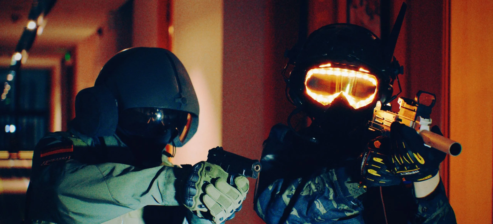

<table>
<tr>
<td width="80" align="center"></td>
<td>Hey, Ash is up ahead, let's go take her out！</td>
</tr>
<tr>
<td width="80" align="center"></td>
<td>Hurh？</td>
</tr>
</table>

### Hazbin Hotel — Alastor, the Radio Demon

  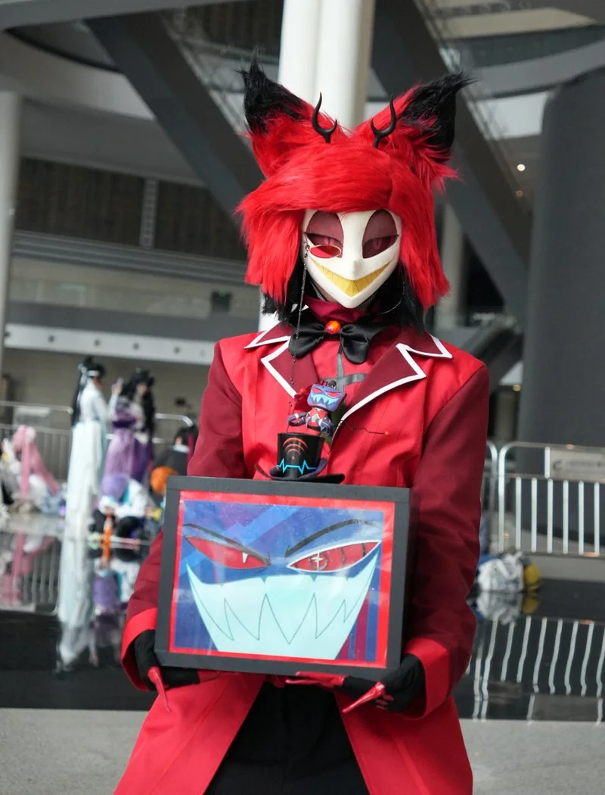

📍 2026 成都世界动漫展 · 5.1 – 5.4

<table>
<tr>
<td width="80" align="center">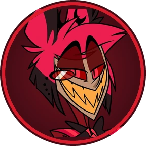</td>
<td>You're never fully dressed without a smile！</td>
</tr>
<tr>
<td width="80" align="center">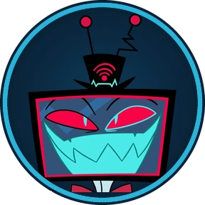</td>
<td>...Put me down, Alastor.</td>
</tr>
</table>

对话头像取自角色官方立绘（Alastor render by OKDraws），来源 <a href="https://hazbinhotel.fandom.com/">Hazbin Hotel Wiki</a>。

  

🌅 <i>See you on the other side of the sunset.</i>

